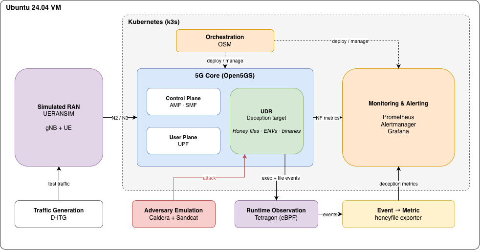

# Orchestrating Illusions - Designing Deceptive Assets for Orchestrated 5G Networks


Welcome to the GitHub repository of my Master's thesis. This repository contains the code developed for a cyber deception prototype that integrates deceptive assets into a Kubernetes-based 5G standalone core using Open5GS, with automated deployment, attack simulation using Apache CALDERA, and pod monitoring through Tetragon and Prometheus.


|                          |                                                                                  |
| ------------------------ |----------------------------------------------------------------------------------|
| Student                  | Thu An Phan                                                                      |
| Supervisor               | Andy Aidoo                                                                       |
| Supervisor               | Thomas Grübl                                                                     |
| Responsible Professor    | Prof. Dr. Burkhard Stiller                                                       |
| Contents                 | Repository for prototype that has been developed as part of the Master's Thesis. |


## Feature Description

The prototype introduces deceptive resources into a real running network function rather than relying on a separate, standalone honeypot. The UDR continues to operate as part of the 5G core while selected files, environment variables, and executable resources act as decoys. Attacker interactions are observed using kernel-level telemetry and exposed through monitoring dashboards and alerts.

| Feature | Description                                                                                                                                                                                      |
|---|--------------------------------------------------------------------------------------------------------------------------------------------------------------------------------------------------|
| **Configurable honeyfile generation** | Generates plausible deceptive files under `/opt/open5gs`, using existing directory contents and naming conventions. Honeyfile density can be configured independently of other deceptive assets. |
| **Deceptive environment variables** | Adds a fixed set of credential- and database-related environment variables to the UDR container.                                                                                                 |
| **Deceptive binaries and processes** | Deploys a fixed set of executable wrappers and traps, including command-like utilities and a long-running deceptive process, to observe attempts to invoke them.                                 |
| **Automated deployment and cleanup** | Uses scripts and Kubernetes commands to install, track, and remove deceptive resources between experiments.                                                                                      |
| **Asset manifests** | Records deployed assets so discoveries and interactions can be compared against a known ground truth.                                                                                            |
| **Attacker emulation** | Uses Apache Caldera to execute controlled post-compromise discovery, collection, credential-access, execution, and exfiltration activities.                                                      |
| **Runtime monitoring** | Uses Tetragon/eBPF to observe process execution and file access in the targeted UDR pod.                                                                                                         |
| **Metrics and dashboards** | Exposes deception-related metrics to Prometheus and visualizes them in Grafana.                                                                                                                  |
| **Alerting** | Uses Prometheus alert rules and Alertmanager to flag interactions with deceptive resources.                                                                                                      |
| **5G traffic evaluation** | Uses UERANSIM to simulate UEs and a gNB, and D-ITG to evaluate user-plane traffic under different configurations.                                                                                |

## System Architecture

The prototype runs on a single Ubuntu virtual machine hosting a single-node k3s cluster. Open5GS provides the 5G core, while UERANSIM supplies simulated radio access and user equipment. Deceptive resources are deployed in the UDR pod in the `open5gs` namespace.




The diagram is a conceptual overview, not a complete Kubernetes network or data-flow diagram. In particular, D-ITG traffic is carried through the simulated UE/gNB and the Open5GS user plane, while Caldera activity is directed at the compromised-network-function scenario.

### Main Technologies

| Component                                                              | Purpose |
|------------------------------------------------------------------------|---|
| [k3s](https://k3s.io/)                                                 | Lightweight Kubernetes cluster |
| [Open5GS](https://open5gs.org/)                                        | 5G standalone core network |
| [UERANSIM](https://github.com/aligungr/UERANSIM)                       | Simulated gNB and UEs |
| [Apache Caldera](https://caldera.apache.org)                           | Adversary emulation and attack campaigns |
| [Tetragon](https://tetragon.io/)                                       | eBPF-based process and file-access observation |
| [Prometheus](https://prometheus.io/)                                   | Metrics collection and alert-rule evaluation |
| [Grafana](https://grafana.com/)                                        | Monitoring dashboards |
| [Alertmanager](https://prometheus.io/docs/alerting/latest/alertmanager/) | Alert handling |
| [D-ITG](https://traffic.comics.unina.it/software/ITG/)                 | Traffic generation and performance measurements |
| Python and Bash                                                        | Experiment automation, asset generation, and evaluation |

### Deceptive Asset Types

**Honeyfiles.** Files are generated with names and contents that resemble operational configuration, backup, certificate, or database resources. The generator scans the target directory structure, allocates new files proportionally across directories, avoids name collisions, and writes a manifest of deployed files. A seed supports reproducible generation; dry-run mode allows inspection before deployment.

**Honey environment variables.** Five fixed environment-variable lures represent database addresses, backup locations, key paths, and tokens. They are injected into the UDR deployment through Kubernetes. Because environment variables are part of a container's startup environment, applying or removing them requires a rollout restart.

**Honey binaries and processes.** The prototype includes deceptive command variants, executable traps for commonly used utilities, and a long-running process. Execution of these resources is treated as stronger evidence of engagement than merely discovering their names.

Only **honeyfiles** are varied by the experimental density parameter. The environment variables, binaries, and processes are proof-of-concept asset types deployed in fixed configurations.

### Experimental Configurations

The evaluated honeyfile density configurations are **0%, 25%, 50%, 75%, and 90%**. Density refers to the proportion of deceptive files relative to real and deceptive files in the selected file population. Other asset types are not scaled with density.

The 0% configuration is a baseline **without honeyfiles**, but it is not a completely deception-free configuration: the experiment retains two behavioral executable traps. The evaluated maximum is 90%, constrained by the available file-naming pool.


### Detection and Alerting

The monitoring pipeline observes file-access and process-execution events in the UDR pod and converts relevant events into metrics. The final experimental alert conditions are:

| Condition                                          | Severity |
|----------------------------------------------------|---|
| At least 3 honeyfile interactions                  | Warning |
| At least 3 honey environment-variable interactions | Warning |
| At least 1 deceptive binary interaction            | Warning |
| At least 1 deceptive binary execution              | Critical |
| At least 5 subspicious binary execution            | Critical |


## Running the Prototype Locally

Unlike a single-container application, this prototype depends on a functioning Kubernetes-based 5G testbed and several external components. The following sections provide a setup checklist and representative verification commands.

### Prerequisites

- An Ubuntu 24.04 LTS host or virtual machine with sufficient CPU, RAM, and storage for the testbed.
- Git, Python 3, Bash, and Kubernetes command-line access (`kubectl`).
- A running k3s cluster with the Open5GS core deployed in the `open5gs` namespace.
- UERANSIM configured to connect its simulated gNB and UEs to Open5GS, which can be configured with [SetUp UERANSIM and NGAP](./tools/d-itg/scripts/setup-ueransim-environment.sh).
- Apache Caldera adversary configured for the controlled experiment. Unfortunately, Apache CALDERA encountered issues when exporting the customized adversary or provided adversary, so an importable YAML file could not be provided. However, the adversary can be recreated manually by assembling the individual abilities and applying the necessary customizations. The screenshot at [Simulated Adversary Steps in Caldera](Figures/Screenshot_of_Simulated_Adversary.png) and the experiment log at [caldera_csv.csv](./experiments/experiment-campaigns/density-90/run1/caldera_csv.csv) provide a reference for the sequence of commands used in the simulated attack. The eigth and the last step are custom abilities and not part of the default Caldera set.

- Tetragon configured to observe the target UDR pod.
- Prometheus, Grafana, and Alertmanager configured for the experimental metrics and alerts.
- D-ITG for traffic-performance experiments.

Network interfaces, IP addresses, Helm release names, UE subscriber data, and service endpoints must match the local testbed. Do not reuse VM-specific addresses or credentials without adapting them.

### Configure and Deploy Deceptive Assets

The deployment tooling should be run against the intended namespace, pod, and filesystem root. In the thesis experiments, the principal target was:

```text
Namespace:       open5gs
Target NF:       UDR
Pod selector:    app.kubernetes.io/name=udr
Filesystem root: /opt/open5gs/etc
Density values:  0, 25, 50, 75, 90 percent
```

Use the asset-generation and deployment scripts provided in the repository to:

1. Deploy the fixed honey environment variables and executable decoys, and safe them in a manifest with [Deploy honey environmetal variable or binary](./tools/deception/deploy-envs-and-binaries.py).
2. Restart the UDR deployment if its environment variables were changed.
3. Generate a density-specific honeyfile and save their manifest with [Deploy Honeyfiles](./tools/deception/deploy-density-dynamic.py).


### Run an Experiment

The experiment each follow the same protocol. The protocols walk through running the experiments and which commands are used to set up the environment before running the experiment, and also shows the steps to take after the experiment finished to save the experiment's data.
For the adversary experiment, follow the steps described here: [Campaign experiment protocol](./Experiment_Protocols/Protocol_Run_Campaign_Exeriment.sh). 
For the Baseline Experiment follow these steps: [Baseline experiment protocol](./Experiment_Protocols/Protocol_Run_Baseline_Exeriment.sh)

## Monitoring and Evaluation Output

The prototype displays generated alerts, honey asset events and resource utilizations in Grafana dashboards. Simply import the configuration into Grafana, to get the dashboards. [Baseline Dashboard](./experiments/Grafana_Dashboard_Configurations/MA_Grafana_DashboardConfig_Baseline.json) and [Campaign Dashboard](./experiments/Grafana_Dashboard_Configurations/MA_Grafana_DashboardConfig_Campaign.json).
The prototype exposes live deception metrics including the deployed honeyfile count, uniquely discovered assets, total interactions, per-type interactions, suspicious execution events, and unique suspicious binaries observed.

The metrics are:

```text
thesis_honeyfiles_total
thesis_honey_assets_discovered
thesis_honey_assets_interacted
thesis_honeyfiles_interacted
thesis_honeyenvs_interacted
thesis_honeybinaries_interacted
thesis_suspicious_exec_events
thesis_suspicious_binaries_seen

```
These live counters are not necessarily identical to the unique-asset counts used in the final evaluation: some counters record repeated events, while others use set semantics. The evaluation should therefore be calculated from the designated ground-truth sources rather than by treating every dashboard counter as a unique-asset count.

